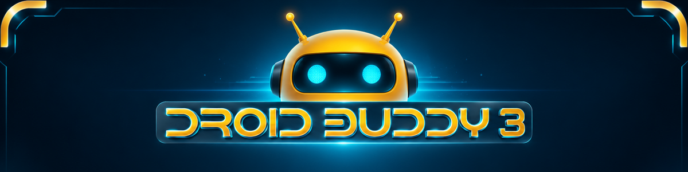

<h1 align="center">DroidBuddy3 Media Center</h1>

  A remote-friendly, open-source home-theater application based on Kodi.

## About DroidBuddy3

DroidBuddy3 is an independent GPL-licensed Kodi derivative with its own product
identity, Android package, launcher artwork, startup splash, and default user
interface. Its bundled `skin.droidbuddy3` skin provides a television-first,
three-column launcher using the midnight navy, electric cyan, and amber-gold
DroidBuddy3 design system.

DroidBuddy3 does not include media, streaming services, third-party repositories,
or third-party add-ons. Users remain responsible for the sources and add-ons they
choose to install.

## Upstream and compatibility

This project is derived from the Kodi source code maintained by Team Kodi and the
XBMC Foundation. The upstream project is available at
[xbmc/xbmc](https://github.com/xbmc/xbmc). DroidBuddy3 is not endorsed by,
sponsored by, or affiliated with Team Kodi or the XBMC Foundation.

Compatibility-sensitive names—including selected `xbmc` namespaces, add-on APIs,
built-in add-on IDs, paths, and protocol values—are retained where changing them
would break existing software. They identify upstream interfaces, not this
product's consumer-facing brand.

## Building

Kodi's existing CMake-based build system is retained. Platform-specific build
instructions remain in [docs/README.md](docs/README.md). Android builds use the
application ID `com.droidbuddy3.media` and display name `DroidBuddy3`.

## Default interface

Fresh profiles start with `skin.droidbuddy3`. Estuary remains bundled as a safe
fallback and can still be selected from interface settings.

## License and attribution

The source remains licensed under the terms described in [LICENSE.md](LICENSE.md).
Original copyright notices and component licenses are preserved. See
[NOTICE.md](NOTICE.md) for derivative-work and trademark information.

